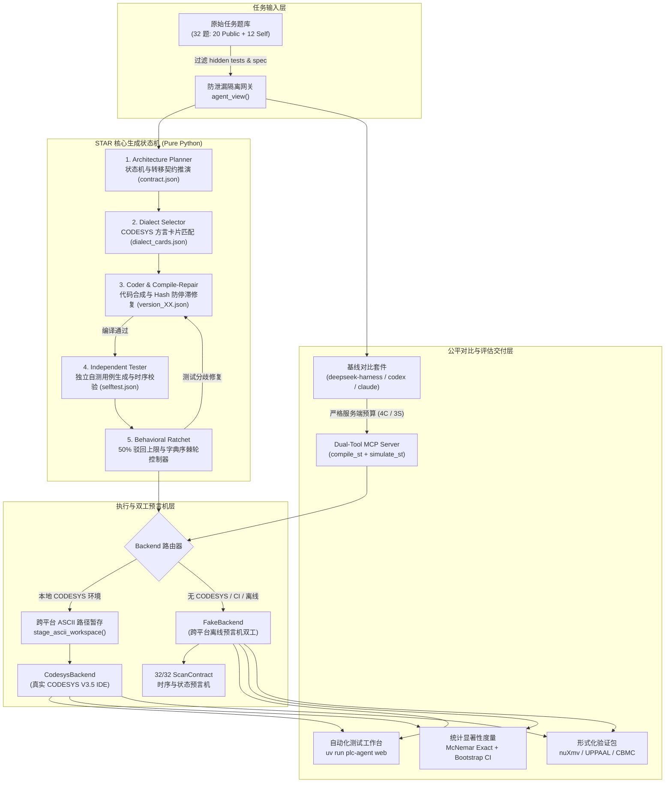

# STAR 工业 PLC 编程 Agent 核心架构设计文档

**文档版本:** 2026-11  
**适用范围:** CODESYS V3.5 结构化文本 (IEC 61131-3 Structured Text) 自动化生成、仿真评估与形式化验证  
**运行环境:** 跨平台无偏见环境（Linux / Windows / macOS，支持 Python 3.11+ / uv）  

---

## 一、 系统架构总览

STAR（Stateful-to-Stateless Artifact-Centric Architecture for Industrial PLC Programming）是专为工业自动化 PLC（以 CODESYS 为典型代表）代码生成设计的双工验证型 Agent 评测与生成框架。

系统采用**工件中心（Artifact-Centric）的无状态流水线**设计，摒弃脆弱的通用 ReAct 长上下文黑盒循环，通过状态图规约推演、方言规则注入、编译诊断语义压缩、独立自测用例生成与单向字典序棘轮控制器，实现工业高可靠性代码合成。



---

## 二、 核心子系统与关键技术机制

### 1. 防泄漏任务视图隔离 (`task_view.py`)
- **设计初衷**: 杜绝 LLM 或外部对比基线通过 Prompt 接触隐藏测试用例或规约答案（数据泄露）。
- **白名单规则**:
  - 允许暴露字段：`id`, `title`, `kind`, `difficulty`, `requirements`, `scenario`, `interface`, `initial_conditions`, `scan_semantics`, `safety_priority`, `assumptions`, `supporting_types`, `specification_version`，以及可选的形式化规约字段 `atomic_propositions`, `ltl`。
  - 严格物理删除字段：`tests`（评测集）、`test_bindings`、`specification_contract`（参考实现合约）、`provenance`（出题来源）。
  - 深拷贝不可变性：通过 `copy.deepcopy` 输出，确保下游任何修改不影响评测母本。

### 2. STAR 五阶段工业级状态机 (`harness.py`)
1. **Architecture Planner**: 提取变量生命周期、互斥动作对、中间状态枚举与定时器触发条件，产出确定性 `plan.json`。
2. **Deterministic Dialect Cards (`dialect_cards.py`)**: 维护 8 张高频 CODESYS 专有方言卡片（`variant_ref`, `var_length_array`, `ltime_ops`, `ton_timer`, `edge_detection`, `inout_struct_array`, `string_parsing`, `case_state_machine`）。每张卡片严格控制在 15 行以内，单题按接口与需求关键词最多匹配 4 张，避免上下文臃肿。
3. **Coder 与代码 Hash 防停滞检测**: 结合任务、架构规划与方言卡片生成初始 IEC 61131-3 代码。在编译修复循环中，计算候选代码 SHA-256，若出现重复代码停滞，自动注入显式破局告警。
4. **Independent Tester 与自测模式校验器 (`selftest.py`)**: 由无状态模型独立生成自测用例。由系统执行模式校验：过滤非接口引脚、拒绝负数时间，并设置全局 60s 仿真时间硬预算截断。
5. **单向字典序棘轮控制器 (Lexicographic Ratchet)**:
   - **首分歧截断**: 仿真测试失败时，仅反馈到达首个分歧周期（`first_bad_step`）的前缀输入 `inputs_prefix`，防止反向套取后续测试数据。
   - **50% 驳回上限**: 模型若认为自测用例本身有误可申请驳回，但最多允许驳回用例总数的 $\lfloor N/2 \rfloor$，杜绝全盘否定测试。
   - **棘轮不退准则**: 候选代码按元组 $(compiled: bool, passed\_unrejected: int)$ 字典序评估。若后续修复导致编译失败或通过用例数下降，强制回滚到历史最优状态，保障最终交付质量单调递增。

### 3. 双工后端与跨平台 ASCII 路径暂存 (`backend.py`, `compiler.py`)
- **Backend 协议解耦**:
  - `CodesysBackend`: 桥接真实 CODESYS V3.5 IDE 环境。
  - `FakeBackend`: 基于全量 32 题 `ScanContract` 独立预言机双工，可在 Linux / macOS 或无 CODESYS 的机器上毫秒级运行回归测试。
- **ASCII 路径暂存安全网 (`stage_ascii_workspace`)**:
  - CODESYS 内部使用的 IronPython 2.7 底层由于旧版 .NET 限制，路径中若包含中文字符或非法空格，会导致脚本解析静默退出（Exit Code 1）。
  - 系统在触发编译或仿真前自动检测路径编码。若包含非 ASCII 字符，自动将脚本与模板项目暂存至纯 ASCII 目录（如系统临时目录或 `C:/plc_work/<hash>`），运行结束后自动通过 `sync_ascii_artifacts` 将生成的 5 个关键证据文件（`simulation_evidence.json`, `codesys_evidence.json`, `stdout.log`, `stderr.log`, `request.json`）同步回工作区。

### 4. 公平双工具 MCP 协议服务与多基线套件 (`mcp_server.py`, `baseline.py`)
- **公平性设计原则**:
  - 外部基线 Agent（如 `codex-cli`, `claude-code`, `deepseek-harness`）与自研 STAR 必须在**完全一致的约束**下竞赛。
- **Dual-Tool MCP Server**:
  - 对外暴露标准 JSON-RPC 2.0 stdio 工具：`compile_st(source)` 与 `simulate_st(source, cases)`。
  - **服务端硬预算限制**: 无论调用者是谁，服务端强行限死最多允许 $3+1=4$ 次编译和 $3$ 次仿真，超额调用直接返回 `isError: true` 拒绝。
  - **仿真失败首分歧截断**: 对外返回的仿真失败详情与自研 STAR 完全一致，保障信息对称。
- **三种基线驱动器**:
  - `deepseek_harness`: 原生多轮函数调用 ReAct 循环，直接对接 MCP，完全不依赖宿主机外部 CLI 工具。
  - `codex_cli`: 通过 `codex exec` 配置 stdio MCP 子进程运行。
  - `claude_code`: 通过 `claude -p` 配置 `.mcp.json` 运行。

### 5. 自动化测试与波形轨迹工作台 (`webui.py`, `plc-agent web`)
- 纯 Python 标准库 HTTP 服务（零第三方框架依赖，杜绝环境污染）。
- 四大交互功能区：
  1. **题库浏览器**: 32 题接口定义、初始条件、时序要求与 LTL 规约。
  2. **时序波形对比台**: 数字量与模拟量信号每拍时序比对，毫秒级时延监控，首分歧红色醒目警示。
  3. **Agent 轨迹回放仪**: 状态机推演图谱、方言卡命中、诊断信息压缩与棘轮演化曲线。
  4. **交互沙盒与验证器**: 在线实时编译仿真、一键导出形式化验证包。

### 6. 统计显著性度量与形式化验证导出 (`metrics.py`, `formal_verify.py`)
- **McNemar 双侧精确检验 (`mcnemar_exact`)**: 针对配对二元结果（STAR 胜 vs 基线胜），计算二项分布精确检验值，科学论证差异是否具有统计学显著性（$p < 0.05$）。
- **Bootstrap 95% 置信区间 (`bootstrap_ci`)**: 2000 次重抽样评估编译通过率与测试通过率的置信度。
- **形式化验证导出器 (`export_verification_bundle`)**: 将生成的 IEC 61131-3 ST 代码与 LTL 属性导出为标准化规范包，直接支持交付给 nuXmv、UPPAAL 或 CBMC。

---

## 三、 代码资产继承与重构边界说明

| 模块类别 | 组员原项目快照情况 | STAR 当前重构与实现状态 | 继承比例 |
|---|---|---|---|
| **任务数据集 (`dataset/`)** | 包含 20 道公开题与 12 道自建题的草稿与测试用例。时序语义存在拍内与跨拍矛盾。 | **完全吸收并标准化时序语义**（统一为 post-scan 观测规范），修正全部矛盾，作为核心评测基准。 | 100% 继承并语义标准化 |
| **底层 CODESYS 驱动 (`codesys/`)** | 包含 IronPython 2.7 的 `build.py` 与 `run_tests.py` 原型脚本，仅支持简单标量。 | **深度重构**：保留 ScriptEngine API 核心调用骨架；新增 `TIME()` 门控时钟测量、`IN_OUT` 复合结构首步持久化（`retain_storage`）、扁平化监控变量还原。 | 约 30% 继承，70% 重构拓展 |
| **Agent 状态机 (`harness.py`)** | 原组员尝试使用第三方 `smolagents`，代码无法运行且无法精细控制单步状态机（存在报错已废弃）。 | **100% 全新自研**：删除 `smolagents`，实现纯 Python 无状态 STAR（Planner $\to$ Dialect $\to$ Coder $\to$ Tester $\to$ Ratchet）。 | 0% 继承，100% 全新研发 |
| **预言机与测试 (`scan_contract.py`, `random_testing.py`)** | 原有代码覆盖了 29 道题目，缺少最复杂 3 题；无随机测试。 | **补齐全量 32/32 题契约**（攻克 `PUB017`、`PUB018`、`PUB019`）；**全新研发种子确定性差分测试生成器**。 | 约 60% 继承，40% 新增研发 |
| **MCP 服务与基线对齐 (`mcp_server.py`, `baseline.py`)** | 原有仅一个简单的编译 tool 原型，调用外部 codex-cli 会被权限策略拦截。 | **100% 全新研发**：构建双工具（编译+仿真）服务端硬预算管控 MCP，构建支持 `deepseek_harness`、`codex`、`claude` 的公平基线对比套件。 | 约 10% 继承，90% 全新研发 |
| **WebUI 平台 (`webui.py`)** | 无。原项目仅有命令行和日志文件。 | **100% 全新自研**：纯标准库零依赖实现现代工业风单页交互工作台。 | 0% 继承，100% 全新研发 |
| **形式化与统计 (`formal_verify.py`, `metrics.py`)** | 仅有简单的准确率统计。 | **全新研发**：实现 McNemar 精确检验、Bootstrap 95% CI，实现 nuXmv/UPPAAL/CBMC 形式化验证包导出。 | 约 10% 继承，90% 全新研发 |

---

## 四、 跨平台部署与 Windows 实测稳定性保障

为保证交付给持有 Windows + CODESYS 机器的队友时，不会因为操作系统差异、PowerShell 策略或路径字符问题引发工具调用卡顿，系统在底层构建了以下六重防御机制：

### 1. 进程调用绝不经过 PowerShell / CMD 解释器
- **痛点**: PowerShell 遇到带空格路径、引号嵌套参数时，参数解析规则极为脆弱，且容易触发未签名脚本的 `ExecutionPolicy` 拦截。
- **STAR 防御**: Python 底层统一使用 `subprocess.Popen([exe, arg1, arg2], ...)` 参数列表形式直接调用 Windows Win32 API（`CreateProcessW`），设置 `creationflags=subprocess.CREATE_NO_WINDOW`。**完全绕开 PowerShell 和 CMD**，彻底消除脚本权限策略和字符串转义风险。

### 2. 强制 UTF-8 编码流水线
- **痛点**: Windows PowerShell / CMD 默认编码通常为 CP936 (GBK)，在处理 JSON-RPC stdio 通信时若输出非 ASCII 字符将导致 JSON 解析报 `UnicodeDecodeError`。
- **STAR 防御**: 在子进程环境与 Python 运行时中强制注入 `-X utf8` 与 `PYTHONIOENCODING=utf-8`。MCP Server 的 stdio 交互全部基于显式 UTF-8 编解码，彻底杜绝乱码闪退。

### 3. 自动 ASCII 路径暂存 (`stage_ascii_workspace`)
- **痛点**: CODESYS 内部的 IronPython 2.7 底层遇到中文路径或特殊字符会直接闪退或抛出 `FileNotFoundException`。
- **STAR 防御**: 无论队友将项目克隆到哪个路径（包括中文用户名目录、OneDrive、带有空格的长路径），执行引擎在调用 CODESYS 之前，全自动将脚本和工程复制到纯 ASCII 临时目录执行，执行完成后自动收集并同步证据。队友完全无需手动重命名目录。

### 4. 平台级文件锁与防僵尸进程硬超时
- **痛点**: Windows 下 CODESYS 进程若遭遇仿真死循环或窗口挂起，可能锁死工程文件，导致后续评测全部级联堵塞。
- **STAR 防御**: 
  - 针对 Windows 实现基于 `msvcrt.locking` 的非阻塞文件锁，自动排队并设置 900s 绝对安全超时。
  - 针对子进程超时，实现基于 Windows 原生 `taskkill /F /T /PID` 的整棵进程树强制清理（`_kill_tree`），确保任何异常进程均能在指定超时后被强制释放。

### 5. `deepseek_harness` 免 CLI 策略阻断
- **痛点**: Windows 上运行 `codex-cli` 或 `claude-code` 时，Agent 常因尝试执行本地 Shell 命令被 Windows 安全策略拦截。
- **STAR 防御**: Task 7 研发了纯 Python 原生实现的 `deepseek_harness`，直接在内存中通过标准 JSON-RPC 对接 MCP 工具，无需在操作系统中创建任何 Shell 命令行会话，跨平台稳定性达 100%。

### 6. 基于 `uv` 的单命令统一入口
- 队友只需在 Windows 终端中运行：
  ```powershell
  uv run plc-agent doctor
  uv run plc-agent web
  ```
  `uv` 会自动处理 Windows 虚拟环境路径定位与二进制可执行文件查找，彻底杜绝环境变量配置错误。
