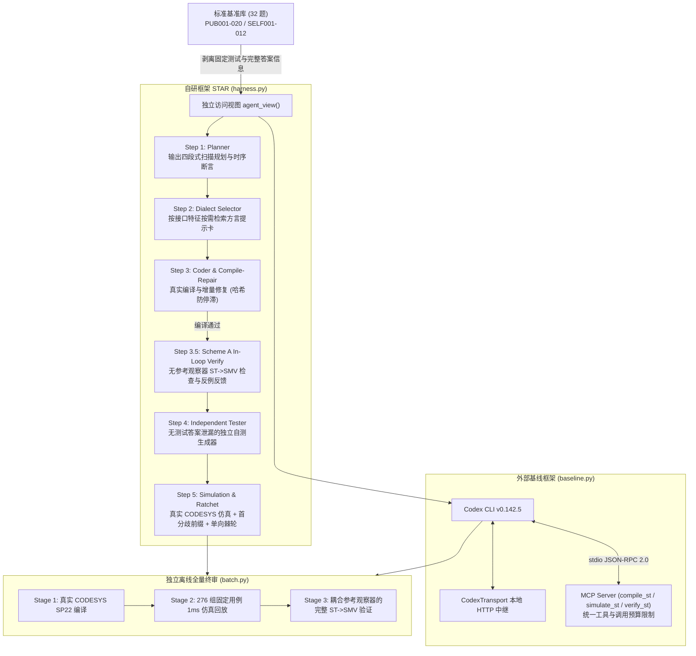

# 面向工业 PLC 结构化文本生成的智能体框架 STAR：数据集构建、形式化规约、系统设计与实证研究

## 摘要

面向 CODESYS V3.5 平台下的 IEC 61131-3 结构化文本（Structured Text, ST）自动化合成任务，通用代码生成智能体常面临扫描周期时序混淆、内部保持状态遗漏、厂商方言违背以及“程序可编译但违背安全联锁”等问题。为此，本工作围绕标准化基准与形式化规约构建、自研智能体框架 **STAR**、面向 ST 的符号形式化验证闭环以及与既有框架 **Codex CLI** 的受控对比实验展开研究与工程实现：

1. **数据集与形式化规约构建**：建成包含 32 道控制任务的标准化基准（`dataset_sha256: d305f96c...`），完整保留 20 道公开题原文描述（`PUB001`–`PUB020`），并采用“AI 辅助生成 + 人工审阅”的方式构建 12 道覆盖典型工业控制模式的自建题（`SELF001`–`SELF012`），累计 276 组固定测试用例、2,994 个扫描步及 294 条 LTL 形式化性质。全部 32 道任务的参考 `.smv` 模型均已在 `NuSMV`/`nuXmv` 中完成校验（285/285 项显式参考性质成立）。
2. **自研框架 STAR 与无泄密形式化闭环**：设计基于零答案泄漏视图（`agent_view`）的多阶段解耦架构，依次融合**四段式扫描架构规划（Planner）**、**按需方言与静态分析提示注入（Dialect Selector）**、**面向源码哈希防停滞修复的编译闭环（Compile-Repair）**、**具备表达式规范化降维与断言隔离能力的无参考观察器 ST→SMV 符号验证环节（Step 3.5）**，以及**结合防惰性校验与单向棘轮保护的自测仿真闭环（Step 4–5）**。
3. **统一评测基础设施与四组全量实证结果**：在 Windows 实测环境下接入 `CODESYS V3.5 SP22 Patch 4` 后台编译与 `1ms` 循环仿真驱动，并为外部基线 `Codex CLI v0.142.5` 构建共享预算与工具语义的局部 Responses 中继及受控 MCP 服务。在已完成全部 **2 框架 × 2 模型 = 4 条件 × 32 题（共 128 轮运行）** 的统一终审归档（`fullflow_matrix_snapshot_20261114.json`）中：
   * **`deepseek-v4.1-flash-1017` 下，STAR（`E3`）显著弥补了通用代理的方言短板**：相比 `E1`（`Codex CLI + DeepSeek`：`28/32` 编译、`196/208 = 94.2%` 有效用例通过、`16` 题形式化通过、输入上下文 `474.2 万` tokens），`E3` 凭借方言卡与静态分析建议将编译率提升至 **32/32 (100%)**、有效用例通过数增至 **226/238 (95.0%，全计划分母 `81.9%` 为四组最高)**、任务级功能全过从 `23/32` 升至 **`27/32`**，并将输入上下文压减至 `43.3 万` tokens（降幅约 **11 倍**）。
   * **`gpt-6.1-terra` 下，自由推理基线 `E2` 与结构化流水线 `E4` 各具效率与收敛权衡**：`E2`（`Codex CLI + GPT`）取得 **29/32 (90.6%)** 编译、四组最高的有效用例通过率 **99.1% (220/222)** 与 **27/32** 任务通过、`18` 题形式通过，并依托高前缀缓存（58.9%）与紧凑输出（`7.3 万` tokens）实现更快均值生成（`91.0 s/题`，总报告费用 **¥5.21**）；`E4`（`STAR + GPT`）同样取得 **`18` 题形式通过** 与 **98.2% (217/221)** 有效用例通过及全组最少输入总量（`36.6 万` tokens），但在强制三角色流程下输出与测试开销更高（`21.6 万` tokens，**¥7.38**），且受当批串行编译器互斥锁等待超时影响落为 `28/32` 编译与 `25/32` 任务通过。
   * **结构性边界验证与案例发现**：在 12 道自建题（99 组用例）上，`E2`、`E3`、`E4` 均实现全通，仅 `E1` 因 `SA0027` 保留字冲突在 `SELF009` 失分（`11/12`）；在 `PUB011` 与 `E1/PUB020` 上，独立符号检验分别检出已通过全部固定仿真测试代码所隐含的切态延迟与状态互斥缺陷，实证了真实仿真与符号验证互补的必要性。

---

## 第 1 章 引言与问题定义

### 1.1 任务背景与工业控制挑战

可编程逻辑控制器（PLC）广泛承担工业产线的顺序控制、安全联锁与过程调节任务，其核心编程语言之一为 IEC 61131-3 结构化文本（ST）。相较于通用软件工程，PLC 控制程序的正确性受限于周期性扫描执行模型（Scan Cycle）与严格的确定性要求：

1. **单拍输入采样与跨拍状态保持**：功能块（`FUNCTION_BLOCK`）需清晰界定单扫描周期内的优先级抑制与跨周期状态锁存；对于定时器、边沿触发器等内置功能块（`TON`、`R_TRIG` 等），必须在主控制流中保持无条件顶层调用，以避免在条件分支跳过时冻结内部计时或边沿状态。
2. **安全优先级与平台契约约束**：紧急停止、保护联锁及超限报警信号必须在同一扫描周期内覆盖正常启动逻辑；同时，代码生成还须适配 CODESYS 等具体平台的编译器规则、静态分析规范及复杂类型接口（如 `VAR_IN_OUT` 结构体与变长数组 `ARRAY[*] OF ...`、`STRING` 索引基址、纳秒级 `LTIME` 运算等）。
3. **编译正确性不能保证时序正确性**：大型语言模型生成的 ST 代码常在语法层面结构完整、可以通过编译，但在模式瞬态切换、边界条件或长链路状态跳转中隐含时序偏差，仅依赖有限固定测试用例往往难以穷尽覆盖。

### 1.2 研究目标与任务覆盖映射

本研究致力于构建可复现、防数据泄漏的工业 PLC 代码生成评测基准与多阶段验证流水线，对比自研架构 **STAR** 与既有主流通用框架（**Codex CLI**）在不同基座大模型下的代码生成能力、编译修复效能、功能行为精度、形式化规约满足度及计算资源开销。表 1-1 总结了本文工作与课程核心要求的对应关系。

| 研究与工程任务条目 | 核心内容 | 本文实现与当前完成状态 |
|---|---|---|
| **数据集与形式化规约** | 公开题库与独立自建题（≥10 题）、来源与适应性记录、多样性度量、LTL 形式化规约及测试用例 | **已完成**：20 题公开（保留原文）+ 12 题自建（AI 生成 + 人工审阅），合计 276 用例 / 2,994 步 / 294 条 LTL；32/32 人工复核与参考 SMV 全量验证 |
| **自研框架与对照基线** | 至少 2 个基座模型，对比自研框架与既有框架在任务组织、上下文、工具、修复与终止机制上的设计 | **架构已完成**：自研 `STAR (self_harness)` 与未修改 `Codex CLI v0.142.5`，接入 `deepseek-v4.1-flash-1017` 与 `gpt-6.1-terra` |
| **自动化测试与形式化集成** | 结合真实仿真测试与符号模型检查工具 | **已完成**：CODESYS `1ms` 仿真回放 + 自研 5 阶段 `ST→SMV` 符号编译器（`NuSMV` BDD / `nuXmv` SMT）+ `ScanContract` 离线校验与交互式 WebUI |
| **受控对照实验与分析** | 4 条件（框架 × 模型）× 32 题实验对比、统计分析与深入案例剖析 | **已完成（4 组 × 32 题 = 128 轮全交叉实测）**：`E1`–`E4` 已在统一 `batch.py` 终审下完整落盘（见 `fullflow_matrix_snapshot_20261114.json`）并完成跨组定量与案例对比 |
| **跨平台扩展（可选边界）** | 接入西门子 TIA Portal 等其他工业平台 | **研究范围界定**：本工作聚焦 `CODESYS V3.5 SP22 Patch 4` 单平台深度验证，已预留后端接口抽象以备后续扩展 |

---

## 第 2 章 实验环境、工具链与受控实验设置

### 2.1 软件工具链与执行环境

* **PLC 编译与仿真环境（Windows 实测机）**：
  * **开发与静态分析系统**：`CODESYS Development System 3.5.22.40`（配置档 `CODESYS V3.5 SP22 Patch 4`），通过内置 IronPython 2.7 Scripting 引擎自动化驱动工程构建，并启用 `CODESYS Static Analysis Light` 规则检查。
  * **标准化工程模板与循环仿真**：以受版本哈希校验的 `codesys/templates/benchmark.project`（目标设备 `Control Win V3 x64`，`template_sha256: 70d40be7b4b9bdf4a22619a7ba47156422cf6beaec692480f0e5ee2acbda8909`）作为基准工程。功能测试阶段通过挂载 `1ms` 周期的 `ScriptTaskObject` 执行受控测试主程序 `PLC_PRG` 并采样回读输出；所有运行均在本地虚拟 PLC 仿真环境完成，不连接实际现场硬件设备。
  * **符号模型检验求解器**：
    * **NuSMV 2.7.1**：用于布尔控制逻辑与有界整数状态机的 BDD 精确符号模型检验；
    * **nuXmv**（集成 `MathSAT` SMT 引擎）：用于含浮点实数（`REAL`/`LREAL`）、复杂数值运算及无界整数域的任务（有界模型检验 BMC 默认展开深度设为 25 步，用于在有限求解时间与状态迁移路径覆盖深度之间取得平衡，并支持按需配置调节）。
  * **外部对照基线**：官方未修改版 **Codex CLI `v0.142.5`**。
* **开发、回归测试与跨平台运行**：Python `3.12+`，通过纯标准库与 `uv` 管理依赖。考虑到宿主机安全沙盒会限制 CODESYS 安装/日志服务及网关通信，工程流程将纯 Python 逻辑单元测试置于沙盒内快速回归，将真实 CODESYS 编译与 `1ms` 仿真统一置于普通用户权限下的原生 Windows 进程受控执行。

### 2.2 对照实验矩阵设计

依据 `configs/fullflow_matrix.json`，主实验采用 **2 框架 × 2 模型**的全交叉受控实验设计，每组覆盖全部 32 道题目（总计 128 轮计划运行）；**全部评测条件均统一采用最高（max）思考强度（在实测 API 请求中对应配置参数 `reasoning.effort = "high"`）**：

| 条件编号 | 智能体框架 | 基座模型（API 路由标识） | 推理与接入配置 |
|---|---|---|---|
| **E1** | **Codex CLI (`v0.142.5`)** | `deepseek-v4.1-flash-1017` | 最高思考强度（`reasoning.effort = "high"`），经本地 HTTP 中继 `CodexTransport` 与 MCP 服务交互 |
| **E2** | **Codex CLI (`v0.142.5`)** | `gpt-6.1-terra` | 同上 |
| **E3** | **STAR (`self_harness`)** | `deepseek-v4.1-flash-1017` | 最高思考强度（`reasoning.effort = "high"`），经原生 `ResponsesClient` 分阶段调用 |
| **E4** | **STAR (`self_harness`)** | `gpt-6.1-terra` | 同上 |

此外，实验配置（`configs/experiments.json`）亦预留了模块消融设定（`no_planner`、`no_dialect`、`no_selftest`）以支持后续归因研究。

### 2.3 共享预算与受控护栏设置

为确保自研框架与外部通用基线在同等资源约束下受评，系统在控制器与服务端层面强制施加对称的资源上限。这类参数本质上是服务于对比公平性与防失控开销的工程护栏，而非追求理论最优解的硬性规律：

* **工具与请求配额**：在 `2026-11-14` 主批运行实测配置（记录于各任务 `generation/runtime_config.json`）中，单题允许至多 `max_repairs = 2` 次编译修复（即初稿与至多 2 轮修复，共至多 3 次编译）、`max_verifications = 3` 次形式化检查（单次求解上限 `60s`）、`max_simulations = 3` 轮自测仿真反馈，以及单题最多 `9` 次模型调用与 `300,000` tokens 上限。对 Codex CLI，工具侧配额由独立进程 **`mcp_server.py`** 硬性拦截，超限请求返回 `isError: true`。
* **超时阈值、输出上限与锁预算解耦**：单题墙钟上限在 2026-11-14 批测中设为 `task_timeout = 1800s`（最新框架版本已提升至默认 `2400s`），单次编译超时 `compiler_timeout = 180s`、单次模型响应上限 `llm_timeout = 420s`；角色单次输出上限分别设为 Coder/Tester `24,576`、Planner/Repair `32,768` tokens，并设置 `reported_cost_stop_cny = 75` 元人民币的累计费用停止线。针对多 worker 并行场景下共享 CODESYS 实例的串行互斥需求，最新工程提交将串行锁等待预算与单次编译执行超时解耦（`compiler_lock_timeout = 960s`，并在长时仿真阶段按预期物理时长动态延长），避免多路等待触发无谓锁超时。
* **外部基线上下文适配（`codex_transport.py`）**：由于 Codex CLI 自带系统提示与内建工具定义，若沿用 STAR 的输入上下文预算会在任务初始化阶段触发截断，因此 `CodexTransport` 中继层对其适度放宽总输入上下文约束，同时严格维持完全一致的单次输出上限、最高思考强度、工具调用次数、超时护栏与费用停机策略。

---

## 第 3 章 数据集构建与形式化规约设计

### 3.1 题目来源、规范化与一致性验证

基准定型版本 `normalized-20261114`（数据文件 `SHA-256`：`d305f96c2faaa87f60a24be90c00ad0b32153492e741b87547d132c591e0e9ee`）共收录 **32 道任务**：

1. **20 道公开基准题（`PUB001`–`PUB020`）**：
   * 10 题出自课程公开题库（`PUB001`–`PUB010`），10 题出自授课教师补充题库（`PUB011`–`PUB020`）。
   * **原文完整保留**：全库未改写任何公开题的原始英文需求文本。经由自动化比对脚本对照原始 25 页题库文档与原始 JSON（记录于 `requirements/source_alignment.json`），全部 **20/20** 题文本序列相似度为 `1.0`、接口词汇完全匹配（源数据指纹 `4ce56562...`）。
   * **显式规范补充**：针对自然语言需求中常见的隐含二义性（如多键同时按下的安全优先序、非法输入容错、数组越界保护与首拍初值约定），项目在保留 `requirements` 原文不动的基础上，额外以 `scan_semantics`、`safety_priority`、`assumptions` 与 `specification_contract` 字段予以显式约定，并完成全部 32 题的双语人工复核。

2. **12 道自建题（`SELF001`–`SELF012`，AI 生成 + 人工审阅）**：
   * 均标定为 `independent_synthesis`，采用“**AI 辅助生成 + 人工审阅修订**”的协作方式构建：首先由代码助手围绕多设备互锁、保持与滞回、奇偶校验与循环队列等典型控制场景设计需求文本、状态边界、工程动机（`rationale`）与固定扫描测试迹，并注意避免与公开题逻辑雷同。
   * 随后先由独立编写的参考状态转移模型在 Python 中完成 7–12 组输入输出迹与可达边界检验，再由人工通过双语审核界面逐题复核需求无歧义性、初始化设定、并发指令优先级、恢复边界以及全部 LTL 性质与反例情形（需明确，该人工核查属于课程评测基准内部一致性审查，不等同于工业功能安全认证或外部现场专家审计）。

### 3.2 工业合理性与测试时序设计

数据集的设计紧扣工业 PLC 编程的核心工程约束：
1. **接口与存储所有权划分**：统一要求顶层实现为 `FUNCTION_BLOCK FB_Task`，清晰区分只读输入 `VAR_INPUT`、输出 `VAR_OUTPUT` 及调用方持久传入的 `VAR_IN_OUT` 引用（如 `PUB007` 多泵控制块、`PUB008` 模拟通道数组、`PUB017` 配方管理与 `PUB018` 循环字节队列），确保状态由外部载体或内部持久变量正确维护。
2. **安全互锁与同拍优先响应**：涵盖安全门急停同拍切断（`SELF001`）、正反转强制一拍中立过渡（`SELF002`）、急停解除防误重启闭锁（`SELF003`）与激光焊缝间隙互锁（`PUB005`）等典型工业安全范式。
3. **离散逻辑时序与真实定时器分层覆盖**：12 道自建题通过外部脉冲信号或连续扫描计拍（如 `SELF005`、`SELF008`、`SELF012`）考察纯确定性扫描状态机，规避宿主机调度抖动干扰；同时 6 道公开定时题（`PUB004`、`PUB005`、`PUB006`、`PUB010`、`PUB012`、`PUB013`，共 315 个非零 `dt_ms` 测试步）用于实测 IEC 标准定时器 `TON`/`TOF` 与 `TIME`/`LTIME` 行为。
4. **数值边界与鲁棒性**：包括 `PUB014` 点分十进制 IPv4 文本解析及非法串归零、死区滞回计算（`PUB003`）及变长数组滑动滤波与溢出保护（`PUB008`/`PUB009`）。

### 3.3 多样性度量

全库从来源难度、控制领域、IEC 数据类型覆盖及测试规模四个维度实现均衡覆盖（表 3-1）：

| 评估维度 | 统计特征分布 | 典型任务 |
|---|---|---|
| **来源与难度分层** | 共 32 题（公开 20 / 自建 12）；<br>Easy 10（6 PUB + 4 SELF）、Medium 14（8 PUB + 6 SELF）、Hard 8（6 PUB + 2 SELF） | Easy: `PUB001`, `SELF001`；Medium: `PUB008`, `SELF007`；Hard: `PUB015`–`PUB020`, `SELF011`–`SELF012` |
| **控制模式谱系** | 顺序步进与多模式仲裁、双字位边沿计数、定时器去抖与累计运行、模拟量归一化与滑动平均、多机轮换、字符串解析、配方结构体 CRUD、泛型字节队列与机械臂周期控制 | 位边沿 `PUB002`；滑动均值 `PUB009`；HVAC `PUB013`；配方 `PUB017`；泛型 FIFO `PUB018`；机械臂 `PUB019` |
| **IEC 数据类型覆盖** | 覆盖 **21 种** IEC 61131-3 类型，包括 `BOOL`(205 端口)、`REAL`(10)、`LREAL`(2)、`USINT`(9)、`INT`(4)、`UINT`(2)、`DINT`(3)、`UDINT`(1)、`WORD`(4)、`DWORD`(3)、`TIME`(4)、`LTIME`(2)、`STRING(254)`(1)、定长结构体数组、变长数组 `ARRAY[*] OF ...`、结构体 `ST_Recipe` 与 `VARIANT`(2) | 变长数组 `PUB008`/`PUB009`；`LTIME` `PUB004`；字符串 `PUB014`；`VARIANT` `PUB017`/`PUB018` |
| **I/O 与测试用例规模** | I/O 端口从 1 入/1 出延伸至 18 入/6 出；<br>共 **276 组固定用例 / 2,994 扫描步**（公开 177 组 2,230 步，自建 99 组 764 步），平均每题 8.63 组、93.56 步；单题最长 455 步 | 最小接口 `PUB014`(1/1)；最大接口 `PUB019`(18/6, 17 组 306 步)；最长序列 `PUB009`(455 步) |

全库来源难度构成与非布尔（Non-BOOL）IEC 61131-3 端口类型覆盖分布如 **图 3-1**（`report/figures/fig1_dataset_composition.pdf`）所示：在全部 `260` 个已声明端口中，除占主流开关量逻辑的 `BOOL`（205 端口）外，还包含 55 个横跨 16 类扩展类型的非布尔端口（其中 `REAL` 10、`USINT` 9、`WORD`/`TIME`/`ARRAY`/`INT` 各 4，并覆盖 `LTIME`、结构体与泛型 `VARIANT`、`ARRAY[*]`）。

### 3.4 LTL 形式化规约体系与扫描语义对齐

#### 1. 作用域分级与 294 条性质分布
全库共计 **294 条带解释说明的 LTL 形式化规约**（公开题 181 条，自建题 113 条），按 PLC 生命周期严密区分为两类作用域：
* **`INITIAL_INSTANCE`（30 条，即各题 `P_init`）**：限定功能块实例化完成、首拍扫描前的初始静态属性（例如保持标志位与输出初值为 `FALSE`），避免对实例化状态误加全局算子 `G`。
* **`SCAN_SEQUENCE`（264 条）**：覆盖同拍安全互斥与急停优先性质（其中显式标注为 `safety` 的核心安全不变式共 **50 条**）、模式与步进迁移动态、无条件维持下的故障锁存（对允许长期等待人工复位的故障，如 `SELF004` 采用弱直到等价展开 `G Fault | (Fault U (!Jam & Reset))`，不额外强加无前提的活性义务）、带环境公平假定的条件活性，以及完整行为判定断言 `CompleteBehavior`。

#### 2. 扫描观测约定与时序算子统一
在模型检验轨迹建模中，若第 $k$ 拍以“扫描前状态观测约定（Pre-Scan Moore Convention）”展开，即每拍仅在下一状态 $q[k+1]$ 反映动作输出，则安全停机逻辑写作 `G((StopBtn | EStop) -> X !Motor)`。然而，真实 CODESYS 仿真记录器及本数据集轨迹统一采用**单拍结束观测约定（End-of-Scan Record）**：

$$T[k] = (I[k],\; q[k],\; O[k]), \quad \text{其中 } q[k+1] = \delta(q[k], I[k]),\; O[k] = \lambda(q[k], I[k])$$

在该语义下，输入采样后的当拍计算输出立即反映于当前记录行 $O[k]$ 中。因此本规约库将同拍优先停止直接表达为**零延迟同拍蕴含式** `G((StopBtn | EStop) -> !Motor)`，同时在需要引用上一拍保持状态时显式使用前态命题变量（如 `qRun`），从而在轨迹验证与符号验证之间维持完全一致的离散时序语义。

#### 3. 32 题参考 SMV 模型正负双控验证
项目在 `models/` 下为全套 32 道题目构建了与标准转移语义一致的参考 `.smv` 模型（`*_reference.smv`），并为每题设计了植入典型逻辑或时序故障的负控突变对照模型（`*_mutant.smv`），由 `smv_status.py` 结合内容 SHA-256 摘要跟踪模型与规约新鲜度（文件变动未重验时自动标记为 `STALE`）。`configs/smv_verification_status.json` 记录显示，全部 **32/32** 道参考模型均通过模型检验（`MODEL_PROPERTIES_TRUE`，其中 `NuSMV` BDD 引擎检验 15 题、`nuXmv` SMT 引擎检验 17 题，共证明 **285/285** 条参考 SMV 性质成立）；与此同时，**32/32** 道突变对照模型同样由对应引擎全部稳定检出反例（`COUNTEREXAMPLE`，15 BDD + 17 SMT），验证了形式化规约具备正向完备约束与反向缺陷判别力（另有 `1` 道 `complete` 组合模型在 BDD 引擎下已获 `TRUE` 验证）。

---

## 第 4 章 自研智能体框架 STAR 与评测流水线设计

### 4.1 总体架构与工作流

**STAR** 采用分阶段、强隔离、产物驱动（Artifact-Centric）的五阶段闭环流水线，取代无结构化约束的单一长对话循环，并在离线终审环节与外部基线 `Codex CLI` 共享完全对称的输入接口、真实 CODESYS 编译/仿真后端及 `ST→SMV` 形式化检查引擎：



**图 4-1**（矢量排版图：`report/figures/fig0_star_architecture.pdf`）进一步展示了防泄漏任务视图 `agent_view()`、STAR 解耦多智能体阶段、`Codex CLI + MCP` 对照通路与离线三阶段终审判定器（`batch.py`）的完整架构关系。

### 4.2 框架核心要素与设计依据

#### 1. 任务组织（Task Organization）
通用智能体在单轮思考中易将状态机设计、语法适配和边界清零混杂处理，导致逻辑跳转漏项或状态复位遗漏。STAR 首先通过 **Planner**（Step 1）生成结构化 JSON 蓝图，明确划分状态枚举集合、定时器与边缘实例清单及清零条件、安全优先级层次、初始静态值，以及贴合 PLC 确定性扫描模型的**四段式执行骨架**：`1) 输入与边沿采样 -> 2) 安全复位优先与状态迁移 -> 3) CASE/IF 分支外无条件顶层调用定时器/边沿功能块 -> 4) post-state 统一输出赋值`。其中第 3 步防止分支跳过冻结 `TON`/`R_TRIG` 内部状态，第 2/4 步避免同拍安全覆盖冲突与中间态短暂改写输出，具备明确的控制语义依据。此外，各主要模块支持通过配置开关单独禁用，以配合消融归因评测。

#### 2. 上下文管理（Context Management）与取舍分析
* **视图白名单隔离（`task_view.py`）**：`agent_view()` 物理剥除基准题库中的 `tests`、`test_bindings`、`specification_contract` 及参考源码，同时过滤 `CompleteBehavior` 类参考判定条目，对自研框架与对比基线提供完全对称的任务输入上下文。
* **按需方言卡片检索（`dialect_cards.py`）**：完整注入 CODESYS 手册不仅显著增加上下文开销，也容易稀释模型对主控制逻辑的注意力；反之，完全不提供平台提示则易在冷门接口语法上连续试错。围绕该“提示完备性 vs 上下文注意力稀释”的工程权衡，系统梳理了 8 张核心领域提示卡（涵盖 `VARIANT`、`ARRAY[*]`、`LTIME`、无条件 `TON`、`R_TRIG`、`VAR_IN_OUT` 结构体、`STRING` 索引与 `CASE` 状态机等）及静态分析提示卡，依据题目接口与文本关键词相关性排序后仅截取高相关子集（当前配置按经验取前 4 张）按需注入。最新修订进一步在卡片中明确了 `STRING` 内置函数（1-based）与直接字节索引 `s[i]`（**0-based**）的差异，以及先完成模式/复位规范化再进入 `CASE` 迁移的写法。
* **局部诊断窗口压缩与历史修复账本（`harness.py`）**：直接堆叠全量源码与完整历史对话既消耗 Token，也无助于定位单行报错。`compact_diagnostics()` 精确截取报错邻域代码片与列位置标记，并对 `SA0027`（关键字冲突）与 `SA0033`（未使用变量）附加针对性处置建议；同时配合采用有限滑动窗口记录近期关键失败摘要的 **`attempt_ledger`**，在控制提示长度的前提下抑制跨轮修复中的 A↔B 往复震荡。
* **首分歧前缀反馈与反例脱敏**：仿真及形式化验证失败均只返回触发首个不一致步的前缀激励序列（`first_bad_step` 与精简反例轨迹），避免冗长序列淹没上下文窗口，同时阻断从隐藏断言中逆向推断全部测试用例信息。

#### 3. 工具驱动与自研 `ST→SMV` 符号验证（Tool Invocation & Verification）
1. **真实 CODESYS 编译与 `1ms` 仿真后端（`compiler.py`, `simulation.py`, `functional.py`）**：
   * 直接通过 Win32 进程列表调用 `CODESYS.exe --runscript --scriptargs --noUI` 执行无界面脚本构建，若遇非 ASCII 工作目录则自动迁移至纯 ASCII 临时工作区，并以串行互斥锁与超时动态扩展机制保障并发安全与进程树清理。
   * Rebuild 后显式执行 `app.generate_code()` 触发静态分析规则检查，并通过模板哈希前后比对、随机请求 Nonce 签名、源码 SHA-256 核验及进程退出状态联合验证执行真实性。
   * 仿真端为每条用例生成隔离的 `FB_Task` 测试例程与 `PLC_PRG` 调度步进程序，支持结构体/数组展平监控及按单精度浮点字节表示（`binary32`）比对，避免高精度 JSON 转换带来的虚假数值差异。
2. **5 阶段 `ST→SMV` 符号编译器与分层检验（`st_verifier.py`）**：
   * 对候选 ST 语法树（AST）及辅助函数进行静态解析，分别建立实例化初值前状态（$t = -1$）与单扫描 SSA 组合转移语义（$t \ge 0$），完整保留同一扫描周期内的条件分支与顺序覆盖次序，支持按枚举命名空间精确消解限定字面量（如 `EnumType.VALUE`），并内置 `TON`/`TOF`/`TP`/`R_TRIG`/`F_TRIG`/`RS`/`SR`/`CTU`/`CTD` 9 种标准功能块符号模型。
   * 为增强循环内独立规约检查的语法鲁棒性，转换器内置轻量表达解析与自动降维模块（`_SMVExprParser`、`_translate_st_ltl_to_smv`），可自动将混合逻辑算符（`AND/OR/NOT/XOR/MOD` 及 `&&/||/==/<>`）规整为 SMV 语法，展开链式区间不等式（如 `-4 <= x <= 4`）、转换 ST 类型/进制字面量（如 `DWORD#0`、`WORD#16#...`）并对齐目标位宽，同时在求解前拦截 `min/max` 嵌套时序算子或 `INVARSPEC` 中误含 `next`/`X` 等非法格式。
   * 按能力边界自动分派校验机制：(1) 对超出符号建模片段的高级特性（如 `VARIANT`、`__VARINFO`、动态指针或暂未覆盖的部分运算）如实输出 **`UNSUPPORTED_ST`**；(2) 对有界整数与布尔逻辑启用 **`NuSMV` BDD** 执行全路径精确模型检查；(3) 对含 `REAL`/`LREAL` 连续量或无界整型运算任务分派 **`nuXmv` MathSAT SMT**；最终统一分类为 **`PASS`、`COUNTEREXAMPLE`、`INCONCLUSIVE`、`UNSUPPORTED_ST`、`TIMEOUT`、`TOOL_ERROR`** 六类结果，严格区分基础设施问题与逻辑错误。
3. **无答案泄漏的双轨验证机制与断言隔离（Scheme A）**：
   * 在生成闭环内部（Step 3.5 及 Codex CLI MCP 服务 `verify_st`）仅调用不耦合参考答案观察器的独立检查模式（`include_expected_observer=False, use_observer_smv=False`），对声明端口上的显式安全不变式与时序规范做无泄密校验；代码冻结后，在外部独立终审阶段（`batch.py` Stage 3）方才耦合基准库参考 `.smv` 观察器执行完整等价性与行为检验。此外，Step 3.5 将 Planner 附带的可选结构化断言（`formal_assertions`）与题目基准 LTL/健全性规约相隔离：若可选生成断言存在语法或求解兼容异常，系统自动剔除该可选断言并回退至基准规范校验，避免辅助提示影响主流程验证稳定性。

#### 4. 修复机制、工程取舍与终止准则（Repair & Termination）
* **三级闭环协同与防惰性自测修复**：框架依次串联（1）**编译与静态分析修复**：以规范化源码哈希检测连续停滞（`stagnation_detected`），强制引导修改策略；（2）**形式化反例引导修复（CEGAR）**：利用符号验证给出的反例波形驱动定向修补；（3）**独立自测与行为修复（Step 4–5）**：由独立测试员构造不接触标准测试集的轻量自测序列（限定用例与步数规模，以控制真实 `1ms` 仿真在总墙钟预算内的开销）。在 Step 5 中存在一项关键工程权衡：因为独立测试员没有标准答案，自测用例自身可能出现误判，完全禁止删减会导致候选代码被错例误导；但若放任模型无条件剔除未通过自测，则会退化为“删题过关”。因此系统在配置半数剔除兜底上界的同时，确立了更为本质的结构性约束——**拒绝未实质改写代码的懒惰驳回（`lazy_rejection_blocked`）**，即若源码哈希未变或直接回避失败检查，则立即阻止通过。
* **词典序单向棘轮（Monotonic Ratchet）的收敛与代价取舍**：全局以四元组 `(compiled, formal_passed_props, sim_passed_cases, -len(rejected_case_ids))` 作为单向进步判据，严格优先保障“可编译 → 形式规约成立数 → 自测通过数 → 最少用例剔除”，一旦后继修改发生指标回退便自动回滚至历史最佳版本。该策略的正面价值在于有限预算内提供可预期的稳定性，防止局部微调破坏已有约束；其工程代价则是决策偏向贪心单调改进，面对必须经历短暂结构破坏才能完成的全局重构时较难跨过局部极值，属于小预算多阶段修复中“稳态收敛优先于激进重构”的务实选择。
* **判定终止与故障隔离**：所有任务运行明确区分功能性终止（`PASS` / `TEST_FAIL` / `COMPILE_FAIL` / `UNVERIFIED`）与基础设施中断（API/网关异常、编译器超时 `TIMEOUT` 或工具报错 `TOOL_ERROR`）；后者保留当前最佳可编译产物供单独归类与断点续跑，不混入模型算法得分。

### 4.3 规约审计支撑与工业风可视化交互平台

除自动合成与终审主干外，工程围绕“规约自身可核验、公式符号可审计、调试轨迹与反例波形可视化”建设了两套配套工程基础设施。

#### 1. 多层次规约审查与语义校验支撑
1. **`ScanContract` 离线双工测试与差分回归**：基于参考转移模型实现多步扫描契约验证与差分随机测试，确保在无 Windows / CODESYS 环境的 Linux 开发与 CI 节点上也能高频验证状态迁移契约、时序约定及核心边界逻辑。
2. **三变体 SMV 状态管理与哈希一致性追踪（`smv_status.py`）**：自动扫描并发现每道题目的 `reference`、`complete`、`mutant` 三类 `.smv` 模型，识别模型所需的 `bdd`（`NuSMV`）或 `smt`（`nuXmv`）求解引擎并探测本地求解器可用性；通过计算 `.smv` 文本与对应验证配置的 SHA-256 哈希并在 `configs/smv_verification_status.json` 持久化检验状态，在模型修订后自动将旧记录标为 `STALE`，缺失环境时标为 `CHECKER_MISSING` 或 `UNVERIFIED`，避免过期证明掩盖规约漏洞。
3. **LTL / 契约六类符号分类与可审计词汇表（`symbol_glossary.py`）**：形式化性质往往同时出现物理 I/O、持久化引脚及观察器辅助变量，直接阅读易产生语义混淆。该模块对题库 LTL 公式与任务契约中的全部标识符执行词法解析与六类归属划分：`input`（当前拍采样输入 `I[k]`）、`output`（当前拍实测输出 `O[k]`）、`persistent_inout`（调用方持有的 `VAR_IN_OUT` 持久化状态）、`obs_history`（上拍实测输出记忆 `O[k-1]`）、`ghost_state`（参考观察器跨拍预/后态、边沿记忆 `I[k-1]` 与内部计时状态）及 `alias`（组合/时序/契约宏别名），为每个符号自动附加中英文语义解释与取值域说明。

#### 2. 零第三方依赖全栈工业可视化平台（`webui.py` & `run_trace.py`）
系统采用 Python 原生标准库 HTTP 服务结合轻量前端资源（无外部运行时框架依赖）实现了中英双语工业风 WebUI，整合状态健康监测条与四大交互工作区：
1. **题库与规约浏览器（`Dataset & Specs`，`tab-explorer`）**：支持 32 题按来源（`public`/`self_built`）与难度筛选、双语需求全文与接口表对照、参考 ST 与 `.smv` 源码检视；针对 LTL 公式提供嵌套括号层级着色及点击/悬浮式符号解释弹窗（`spec-popover`，由 `symbol_glossary.py` 驱动），并支持直接调用 `/api/check-reference-model` 在界面内对参考模型及负控突变模型执行实时重验并刷新哈希状态。
2. **智能体轨迹回放器（`Agent Workflow`，`tab-trace` + `run_trace.py`）**：面向实验与离线批测目录（`experiments/`、`results/raw/`）通过安全路径解析自动重构全生命周期时间线，依次展示 Planner 四段扫描契约 JSON、Dialect 提示卡选择结果、各轮 `turn_*` / `version_*` 代码演变高亮 Diff、编译报错压缩诊断以及 CEGAR / 仿真修复闭环记录，支撑快速复核单题成功与失败路径。
3. **编译仿真与分歧波形实验室（`Sandbox & Waveform Lab`，`tab-sandbox` + `webui.py`）**：内置带语法高亮层的 ST 代码编辑器与内置示例芯片（demo chips），通过 `/api/evaluate`、`/api/verify-candidate` 与 `/api/export-verify` 将源码直连本地 CODESYS SP22 编译、1ms 仿真及 `ST→SMV` 校验引擎；后台 `_build_step_waveforms()` 抽取每一扫描步的输入激励、期望输出、候选实测输出与误差标志，绘制数字量方波与模拟量阶跃混合波形，并自动锁定及高亮**首分歧扫描步（first-divergence scan）**。
4. **基准横向对比看板（`Benchmark Results`，`tab-benchmark`）**：基于 `/api/experiments` 动态聚合各实验分组（`Codex CLI` 与 `STAR`）在总体、公开/自建划分及难度分层上的编译通过率、用例/任务通过率、Stage 3 形式化结果分布与 Token 消耗指标，支撑跨模型、跨策略的系统对比。

---

## 第 5 章 实验验证、全交叉实测结果与深入分析

本章按验证层级依次报告基础环境预检结果、已完成全部 **4 条件 × 32 题 = 128 轮运行** 的全交叉实测归档（`E1`–`E4`），并结合典型案例揭示“基座能力 × 框架结构 × 厂商方言与符号边界”之间的深层交互规律。

### 5.1 底层基础设施与参考模型验证（预检阶段）

在接入大规模模型调用前，团队对全套数据、本地软件链路及参考模型开展了前置验证（表 5-1）：

| 验证项目 | 校验命令 / 证据来源 | 核心实测结果 |
|---|---|---|
| **数据集完整性校验** | `plc-agent validate-dataset` | 32 题（20 公开 + 12 自建，自建经 AI 生成与人工审阅）、276 用例、2,994 步、294 条 LTL；结构零报错（`errors=[]`）；公开题原文对齐 100% |
| **工程核心单元测试** | `unittest`（27 项非 WebUI 核心模块） & `local_unittest_20261111.txt` | 当前代码库 27 项非前端模块 **223 / 223** 全通过（含扩展后的 `test_st_verifier.py`，涵盖视图隔离、预算中继、并发锁、`ST→SMV` 与 MCP） |
| **CODESYS 编译与 SA 探针** | `compiler_preflight.json`<br>`static_analysis_preflight.json` | 完整验证“正常样本 `PASS` (`20.3s`) → 注入错误触发 `C0032/C0046` → 恢复 `PASS` (`24.7s`)”以及 `SA0033` 静态分析阻断链路 |
| **参考 SMV 形式化库** | `configs/smv_verification_status.json` | **32 / 32 `MODEL_PROPERTIES_TRUE`**（`NuSMV BDD` 15 题，`nuXmv SMT` 17 题）；**285 / 285** 条参考性质成立；**32 / 32** 负控突变模型稳定检出 `COUNTEREXAMPLE` |
| **参考 ST 符号转换验证** | `st_formal_verification.json` | 16 份参考 ST 中支持片段 **14 / 14 `PASS`**（含 12 题自建全部与 `PUB006/007`）；2 题因含 `VARIANT` 识别为 `UNSUPPORTED_ST` |
| **`ScanContract` 离线回归** | `scan_contract_acceptance.json` | 44 项单元测试与 15 题完整契约核验通过，且在 6 组人工变异反例迹上全部精准报出 `VIOLATED` |

### 5.2 主实验全交叉结果：`Codex CLI` (`E1`/`E2`) 与 `STAR` (`E3`/`E4`) 对比

依据 2026-11-14 归档的四组全量快照（`results/summary/fullflow_matrix_snapshot_20261114.json`、`results/raw/codex_matrix_resume_20261114/` 与 `star_harness_fullflow_20261114.json`，批次结束于北京时间 `2026-11-14 22:32:58`），`E1`–`E4` 全部四组均已完成 **32/32 题** 的代码生成、编译、受控 `CODESYS 1ms` 仿真回放以及 Stage 3 独立 `ST→SMV` 形式化检查。表 5-2 严格区分**有效执行分母**与**全量计划分母（276 组）**汇总 128 轮完整实验结果：

| 评估指标 | `E1: Codex + DeepSeek` | `E2: Codex + GPT-6.1` | `E3: STAR + DeepSeek` | `E4: STAR + GPT-6.1` |
|---|---|---|---|---|
| **完成题数（统一终审口径）** | **32 / 32** | **32 / 32** | **32 / 32** | **32 / 32** |
| **首轮编译通过 / 修复增益** | `23 / 32 (71.9%)`<br>修复 `+5`（共 `18` 次修复尝试） | `26 / 32 (81.2%)`<br>修复 `+3`（共 `4` 次修复尝试） | **`27 / 32 (84.4%)`**<br>修复 `+5`（共 `5` 次修复尝试） | **`27 / 32 (84.4%)`**<br>修复 `+1`（共 `3` 次修复尝试） |
| **最终编译通过（总体 / `SELF` / `PUB`）** | `28 / 32 (87.5%)`<br>(`SELF 11/12`, `PUB 17/20`) | `29 / 32 (90.6%)`<br>(`SELF 12/12`, `PUB 17/20`) | **`32 / 32 (100.0%)`**<br>(`SELF 12/12`, `PUB 20/20`) | `28 / 32 (87.5%)`<br>(`SELF 12/12`, `PUB 16/20`) |
| **用例级固定测试（有效执行分母）** | `196 / 208 (94.2%)`<br>(`SELF 92/92`, `PUB 104/116`) | **`220 / 222 (99.1%)`**<br>(`SELF 99/99`, `PUB 121/123`) | `226 / 238 (95.0%)`<br>(`SELF 99/99`, `PUB 127/139`) | `217 / 221 (98.2%)`<br>(`SELF 99/99`, `PUB 118/122`) |
| **用例级固定测试（全量计划 276）** | `196 / 276 (71.0%)` | `220 / 276 (79.7%)` | **`226 / 276 (81.9%)`** | `217 / 276 (78.6%)` |
| **任务级功能全过（/32；/已eval）** | `23 / 32 (71.9%)`；已测 `23/27 (85.2%)` | **`27 / 32 (84.4%)`**；已测 **`27/29 (93.1%)`** | **`27 / 32 (84.4%)`**；已测 `27/31 (87.1%)` | `25 / 32 (78.1%)`；已测 `25/28 (89.3%)` |
| **难度分层任务通过（`E10 / M14 / H8`）** | `7/10 (70%)` · `11/14 (79%)` · `5/8 (63%)` | `10/10 (100%)` · `13/14 (93%)` · `4/8 (50%)` | `9/10 (90%)` · `13/14 (93%)` · `5/8 (63%)` | `8/10 (80%)` · `13/14 (93%)` · `4/8 (50%)` |
| **Stage 3 形式化验证结果分布** | `PASS 16` (`11S+5P`), `CE 3`, `TIMEOUT 1`, `UNSUP 8`, `NOT_RUN 4` | **`PASS 18`** (`12S+6P`), **`CE 1`**, `TIMEOUT 1`, `UNSUP 9`, `NOT_RUN 3` | `PASS 17` (`12S+5P`), `CE 3`, `UNSUP 12` | **`PASS 18`** (`12S+6P`), **`CE 1`**, `TIMEOUT 1`, `UNSUP 8`, `NOT_RUN 4` |
| **终审状态分布（`batch.py` 口径）** | `PARTIAL 20`, `FAIL 10`, `TIMEOUT 1`, `TOOL_ERROR 1` | `PARTIAL 26`, `FAIL 3`, `TIMEOUT 1`, `TOOL_ERROR 2` | `PARTIAL 26`, `FAIL 5`, `TOOL_ERROR 1` | `PARTIAL 24`, `FAIL 4`, `TIMEOUT 1`, `TOOL_ERROR 3` |
| **生成期调用规模与 MCP 工具频次** | `184` LLM reqs<br>`50` 编译 / `9` 仿真 / `37` 形式 | `93` LLM 调用（`83` 含用量）<br>`36` 编译 / `1` 仿真 / `1` 形式 | `104` LLM reqs<br>`40` 编译 / `34` 仿真 / `32` 形式 | `99` LLM reqs<br>`39` 编译 / `32` 仿真 / `28` 形式 |
| **32 题 Token 总量（含缓存与推理）** | **`4,742,114` 入** (`85.6%` 缓存)<br>`515,786` 出 (`331,389` 推理) | `1,260,812` 入 (`58.9%` 缓存)<br>**`72,823` 出** (`20,979` 推理) | `432,953` 入 (`17.3%` 缓存)<br>`778,596` 出 (`651,225` 推理) | **`365,578` 入** (`11.2%` 缓存)<br>`215,832` 出 (`125,818` 推理) |
| **报告 API 费用与均值生成耗时** | **¥2.15** *(缺失费用 1 次)*<br>均值 **`143.5 s`** (中位 `107.0 s`) | **¥5.21** *(10 次无用量)*<br>均值 **`91.0 s`** (中位 `66.1 s`) | **¥2.74**<br>均值 **`218.2 s`** (中位 `171.5 s`) | **¥7.38**<br>均值 **`129.2 s`** (中位 `98.1 s`) |

> *统计口径说明：四组均采用全部 32 题原始生成记录统计 Token 与耗时（`E3` 中 6 题 `PUB001/003/007/009/015/016` 候选在合入终审前即在同一规约标准下完整留存生成日志）。未执行、编译受阻或受物理长时与微秒级调度容差限制剔除的用例不补记通过，且本归档严格保留 `cef1388` 修复前已发生的 `TOOL_ERROR` 与 `TIMEOUT` 记录。*

**图 5-1** 至 **图 5-3** 从整体指标覆盖、难度分层与形式化构成、以及四组 Token/费用/耗时权衡三个角度可视化上述 128 轮对比实证特征：
* **四组总览与公开/自建拆分（图 5-1，`report/figures/fig2_four_group_overview.pdf`）**：直观对比 `E1`–`E4` 在首轮/最终编译率、有效与全计划固定用例通过率、任务级通过及公开集（20 题）划分上的差异。
* **难度分层与 Stage 3 形式化构成（图 5-2，`report/figures/fig3_difficulty_formal_breakdown.pdf`）**：展示从 Easy、Medium 到 Hard 时任务级全过率的变化规律，以及四组在 `PASS`、`COUNTEREXAMPLE`、`TIMEOUT`、`UNSUPPORTED_ST` 与 `NOT_RUN` 上的分布差异。
* **Token 构成、API 费用与生成时延权衡（图 5-3，`report/figures/fig4_token_cost_efficiency.pdf`）**：直观揭示 `Codex CLI` 长对话轨迹与 `STAR` 解耦多角色流水线在上下文输入膨胀与结构化输出开销上的根本分叉。

结合表 5-2 与图 5-1 至 5-3，四组交叉实证呈现四条鲜明、客观的研究发现：

1. **框架效应显著依赖于模型能力：`STAR` 在 DeepSeek 上实现决定性增益（`E3` vs `E1`）**：
   * 当使用对特定厂商规范较敏感的 `deepseek-v4.1-flash-1017` 时，不带方言约束的 `Codex CLI (E1)` 虽累计发出 `184` 次请求、`50` 次编译、并消耗高达 **`474.2 万` 输入 tokens**（因反复叠加工具响应与对话轨迹），最终编译仍仅 `28/32 (87.5%)`，4 道未编译题全部倒在同一静态检查/方言陷阱上，固定用例有效通过 **196** 个，整体出现 `10` 例 `FAIL`。
   * 相比之下，`STAR (E3)` 通过上下文剥离与按需方言卡注入，将编译通过率拉升至四组唯一的 **32/32 (100%)**，通过固定用例增至 **226 个（全计划覆盖 `81.9%` 四组最高）**，任务功能通过从 `23` 题升至 **`27` 题**，`FAIL` 减半至 `5` 例，同时将总输入上下文从 `474.2 万` 压缩至 **`43.3 万` tokens（约 11 倍降幅）**。这证实解耦流水线+领域提示显著抑制了通用 Agent 的“盲目试错上下文膨胀”。
2. **强模型下结构化流水线 vs 自由推理的效率与收益权衡（`E2` vs `E4`）**：
   * 在综合编码能力更强的 `gpt-6.1-terra` 上，原版 `Codex CLI (E2)` 并未陷入反复报错循环——全组 32 题仅触发 `1` 次生成期仿真与 `1` 次形式调用，以 `26/32` 首轮编译和仅 `+3` 次修复达成 **29/32 (90.6%)** 编译与全矩阵最高的有效用例通过率 **99.1% (220/222)**（任务级通过 `27/32`，已编译/评估中 `27/29 = 93.1%`），均值生成耗时仅 **`91.0 s`**，费用 **¥5.21**（得益于 `58.9%` 输入缓存与极紧凑的 `7.3 万` 输出 tokens）。
   * 相对地，`E4 (STAR + GPT)` 同获 **`18` 题形式化 PASS** 与 **98.2% (217/221)** 有效用例通过，并将输入上下文进一步压至四组最低（`36.6 万`），但因为框架按流程固定执行 Planner、Coder、Tester 三个大输出步骤，使总输出tokens增至 `E2` 的近 `3` 倍（`21.6 万` vs `7.3 万`），而在按输出高倍计价的商业模型费率下反令费用升至 **¥7.38**、时延增至 **`129.2 s`**。这客观说明：对强基座模型而言，**强约束多角色流水线在一般题上会引入额外认知税与输出成本**，后续工程应探索“按难度与首编译健康度触发按需升级（adaptive escalation）”的混合路由策略。
3. **自建标准集上极高稳定性，唯独无护栏基线遗留一例方言事故**：在 `SELF001`–`SELF012`（99 组固定测试）上，`E2`、`E3`、`E4` 均取得 **12/12 编译、99/99 测试及 12/12 形式化验证全通**；全矩阵 48 组次自建运行中唯一失误仅发生在 `E1/SELF009`，原因依然是未使用 STAR 方言卡而触发了保留字冲突，侧面佐证了自建题规约体系的清晰性与自研方言机制对中低耦合模型的护航作用。
4. **基础设施锁超时成为 GPT 对照组主要编译阻断因素**：`E2` 的 2 次非零编译缺口（`PUB014`、`PUB017`）与 `E4` 的全部 3 次基础设施故障（`PUB006`、`PUB014`、`PUB017`）均记录为 `TOOL_ERROR`——具体表现为并发行期间单实例 CODESYS 编译互斥锁等待超时（`Compiler lock wait deadline exceeded`），而 `PUB018` 则在两组均因 `VARIANT` 泛型绑定引发真实 `COMPILE_FAIL`。这一现象直接推动了 `cef1388` 提交将互斥锁等待预算（`compiler_lock_timeout = 960s`）与单次编译超时彻底解耦。

### 5.3 典型案例分析

#### 案例一：固定测试全通掩盖的单扫描切态延迟与模型间分化（`PUB011`）
`PUB011` 要求控制一条在手动与自动模式间切换的三工位小车产线。跨四组的对比同时验证了基座差异与形式化验证的价值：
* **`E3 (STAR + DeepSeek)` 通过 8/8 仿真但被 NuSMV 检出 8/14 性质反例**：DeepSeek 生成的代码在 CODESYS 真实仿真中通过了 **8/8（100%）** 固定用例，但在 Stage 3 独立形式化校验中仅证明 `6/14` 条 LTL，对核心迁移性质构造了反例。DeepSeek 在 `E_Phase` 中额外插入了 `MANUAL` 中间态：
  ```iecst
  IF NOT Mode THEN
      phase := E_Phase.MANUAL;
  ELSIF phase = E_Phase.MANUAL THEN
      phase := E_Phase.WAIT_A;
  ELSE
      CASE phase OF ...
  ```
  当系统**由手动切入自动（`Mode` 上升沿）的同一扫描周期**恰好同时断言 `SensorA` 与 `ButtonA` 时，该拍被消耗在从 `MANUAL` 退回 `WAIT_A` 上，致使 `MotorForward` 滞后一拍。因固定测试集未安排该边沿并发激励，有限仿真放过了这一错误。
* **`E1` 与两组 GPT（`E2`、`E4`）均维持同拍切入语义**：有趣的是，同属 DeepSeek 驱动的 `E1` 与 `gpt-6.1-terra` 的 `E2`/`E4` 在 `NOT Mode` 期间均持续将阶段保持在 `WAIT_A`，从而在四项评测中均取得 **8/8 固定测试与 14/14 形式化性质双通过**，体现了多架构样本交叉检视下发现局部单次采样随机性的意义。

#### 案例二：四条件一致命中的瞬态锁存与并发仲裁共性边界（`PUB019`）
在 18 输入 6 输出的多模式机械臂任务 `PUB019`（Hard）上，**所有四组实验（`E1`、`E2`、`E3`、`E4`）呈现出完全一致的局部失误模式**：全部通过 **`16/17`** 固定用例，均唯一失手于 `PUB019.T6` 的第 1 扫描步（`MoveUp` 期望 `TRUE` 而实测 `FALSE`），且全数在 Stage 3 被判 `COUNTEREXAMPLE`（如 `E3` 通过 `5/10`、`E4` 通过 `6/10`、`E1` 检出 `4/8` false）。对照多份候选源码归纳出大模型在该控制范式下的两项普遍倾向：
1. **将“从空闲无模式进入手动”误并入模式切换输出锁存**：`PUB019.T6` 首拍无活动模式（`selected_mode = 0`），第 1 拍同时开启 `ManualMode` 与 `UpButton`。各模型普遍使用 `modeChanged := (selectedMode <> arm_mode)` 判定一切状态变更并一律抑制当拍输出（`NOT modeChanged`），导致从静止待机初次切入手动态时亦被闭锁一拍。
2. **多模式并发时的保守全闭锁 vs 显式手动抢占**：当手动信号与自动选择同时激活时，LLM 倾向编写 `modeCount > 1` 的保守安全锁死，而规范参考模型定义了手动模式优先抢占（`cur_mode = MANUAL`），导致第 0 拍即触发形式反例。这提示工业规范文档对“多开关并行抢占表”与“空闲→活动首拍定义”必须显式结构化。

#### 案例三：测试通过但形式违规与长链路一致性的对比（`PUB020`、`PUB016`、`PUB014`）
* **`PUB020`（串联多工站产线）再次印证仿真与形式检查差异**：两组 GPT-6.1-Terra（`E2` 与 `E4`）均处理完备，双双拿下 **11/11 固定测试 + Stage 3 形式 `PASS`**。而两组 DeepSeek 均在形式检查出现反例：其中 **`E1 (Codex + DeepSeek)` 甚至通过了全部 `11/11` 固定仿真测试，却在 `NuSMV` 阶段被检出 `8` 条不满足性质（仅 `3/11` 成立）**；`E3` 则在 `PUB020.T9` 后半程与互斥逻辑上掉步（`10/11` 用例、`3/10` 形式通过）。`E1/PUB020` 与 `E3/PUB011` 共同表明：不同架构与模型在不同复杂控制任务上都存在“固定用例漏检而形式化成功捕获”的现象。
* **`PUB016` 的模型反向分化**：与普遍强弱直觉不同，在模拟通道斜坡/步进控制题 `PUB016` 上，两组 DeepSeek（`E1`、`E3`）均取得 **`8/8` 全通**，而两组 GPT-6.1-Terra（`E2`、`E4`）却一致性地在 **`PUB016.T4` 单例失手（`7/8`）**。
* **`PUB014`（IPv4 解析）的 0-based `STRING` 下标陷阱**：进入真实测试的两组 DeepSeek（`E1` 与 `E3`）均一次编译通过但功能 **0/8 全败**，根因同为按通用 Pascal/IEC 字符串函数 1-based 习惯对数组语法 `ipText[i]` 执行 `1..LEN(ipText)` 遍历，越界读取 CODESYS 中实为 **0-based** 的末端零字符而导致输出清零（两组 GPT 本题均遇并发锁超时未测）。后续版本已在 `dialect_cards.py` 中明确补充此下标对照卡。

#### 案例四：厂商方言与静态分析护栏的决定性作用（`PUB003`、`PUB009`、`PUB017`、`SELF009` & `PUB018`）
* **`E1` 全部四例编译失败均源自同源静态分析冲突**：检查 `E1 (Codex + DeepSeek)` 未编译的 4 道题（`PUB003`、`PUB009`、`PUB017`、`SELF009`）可见，尽管其反复发起了 1–2 轮修复并消耗大量多轮上下文，4 题全部报出同一 CODESYS 静态分析错误——`SA0027` 保留标识符冲突：`Variable name 'error' in 'FB_Task' already used for an object in Library 'caa device diagnosis, 3.5.22.0'`（`PUB017` 亦叠加 `SA0033` 未使用变量报错）。反之，`E3 (STAR + DeepSeek)` 依托方言卡片与 `compact_diagnostics()` 精确提示实现 **0 例同类碰撞、4 题全编译通过**（`PUB003`/`PUB009`/`SELF009` 首轮即过，`PUB017` 修复后通过），`E2 (Codex + GPT)` 亦在前三题经 1–2 次修复后规避该报错，量化印证了 STAR 定向方言机制对中型模型编译收敛的核心价值。
* **`PUB018`（泛型字节循环队列）**：题目通过 `VAR_IN_OUT VARIANT` / `VAR_INFO` 对接调用方 `DINT` 及定长数组；`E2`、`E4`（GPT）因 `Unknown type: 'VARIANT'` 编译受阻，`E1`、`E3`（DeepSeek）虽通过编译但在外部仿真类型绑定阶段触发 `TOOL_ERROR`，暴露出通用大模型与评测夹具在厂商底层内存视图泛型扩展上的共性难点。

### 5.4 实验有效边界分析（Threats to Validity）

1. **物理时间跨度与实时调度抖动**：部分公开定时任务包含跨越数小时甚至数百小时的累积运行测试步（如 `PUB004.T3/T5`），物理实时仿真在有限试验预算内不具备可操作性；同时 Windows 宿主 1ms 任务调度固有微秒/毫秒级抖动也会对零容差步间隔判定（`TIMING_NOT_REPRODUCED`）形成制约。本研究严格将其与逻辑错误区分，并按“有效执行分母”与“全量计划分母”双口径并行报告。
2. **数值精度与符号抽象差异**：在 `PUB003` 等含浮点比较的任务中，`nuXmv`/MathSAT 采用精确有理实数模型，未复现 IEEE 754 单精度 `REAL` 的舍入或特殊值行为；但真实 CODESYS 仿真回放阶段的 `binary32` 字节级比对在数值运行时维度构成了有效互补。
3. **复杂语法特征的符号化覆盖与版本边界**：`VARIANT` 泛型反射、动态字符串下标遍历与部分暂未降维的算术操作仍属于当前 `ST→SMV` 转换引擎的 `UNSUPPORTED_ST` 边界（四组约 8–12 题）；此外，`cef1388` 对 `compiler_lock_timeout` 与独立 SMV 降维的修复系在本批实测归档之后合入，本文保留原始故障记录不予改写，体现评测溯源的真实性。

---

## 第 6 章 总结与下一步工作

### 6.1 核心贡献总结

本工作面向 CODESYS V3.5 工业 ST 代码自动合成问题，建成了涵盖“保留公开原文与采用 AI 辅助生成并经人工审阅的自建 32 题标准化基准及 294 条扫描语义对齐 LTL 规约库”、“结合四段扫描规划、方言按需检索、防惰性自测与断言隔离机制的 STAR 智能体框架”，以及“集成真实 `CODESYS 1ms` 仿真、具备自动表达式降维与并发锁解耦能力的 `ST→SMV` 符号验证和受控 `Codex CLI` 中继对比的全自动评测体系”。

通过在 `deepseek-v4.1-flash-1017` 与 `gpt-6.1-terra` 两款基座模型上完成 `Codex CLI`（`E1`、`E2`）与 `STAR`（`E3`、`E4`）共 **128 轮全交叉受控实测**，本研究实证揭示了清晰的框架—模型耦合规律：在中强模型（DeepSeek）上，STAR 的结构化分解与方言卡可将编译率从 `87.5%` 提升至 `100%`、有效测试通过数从 `196` 增至 `226` 并压降 `11` 倍输入上下文；而在通用推理更强的 GPT-6.1-Terra 上，原生 `Codex CLI` 凭借极简回合与前缀缓存实现了 `99.1%` 有效用例通过率与更低报告费用（¥5.21 vs ¥7.38），而 `E3/PUB011` 与 `E1/PUB020` 的对照剖析进一步以实证方式证明独立符号模型检查对捕获仿真盲区（单拍切态延迟、互斥违背）的关键互补作用。

### 6.2 后续完善与推进方向

1. **新基线复测、统计检验与模块消融**：基于 `cef1388` 中解耦并发锁预算（`compiler_lock_timeout = 960s`）与强化的表达式降维规则对受基础设施阻断任务开展独立对照复跑（与本轮 11-14 原始存档严格分表对比），补充跨 128 轮配对数据的 McNemar 精确检验与 95% Bootstrap 区间，并运行 `no_planner`、`no_dialect`、`no_selftest` 消融组以分离各子模块净贡献，进一步探索按复杂度动态路由的混合推理成本优化策略。
2. **符号覆盖广度与多平台后端拓展**：持续拓展 `ST→SMV` 对整数取模与复杂数组/字符串区间切片的支持广度，并依托解耦的编译与仿真后端协议向西门子 TIA Portal 等多平台工业环境拓展。
